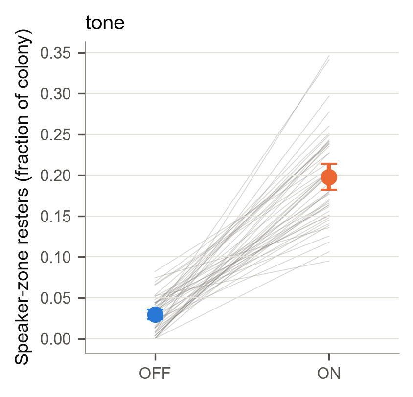
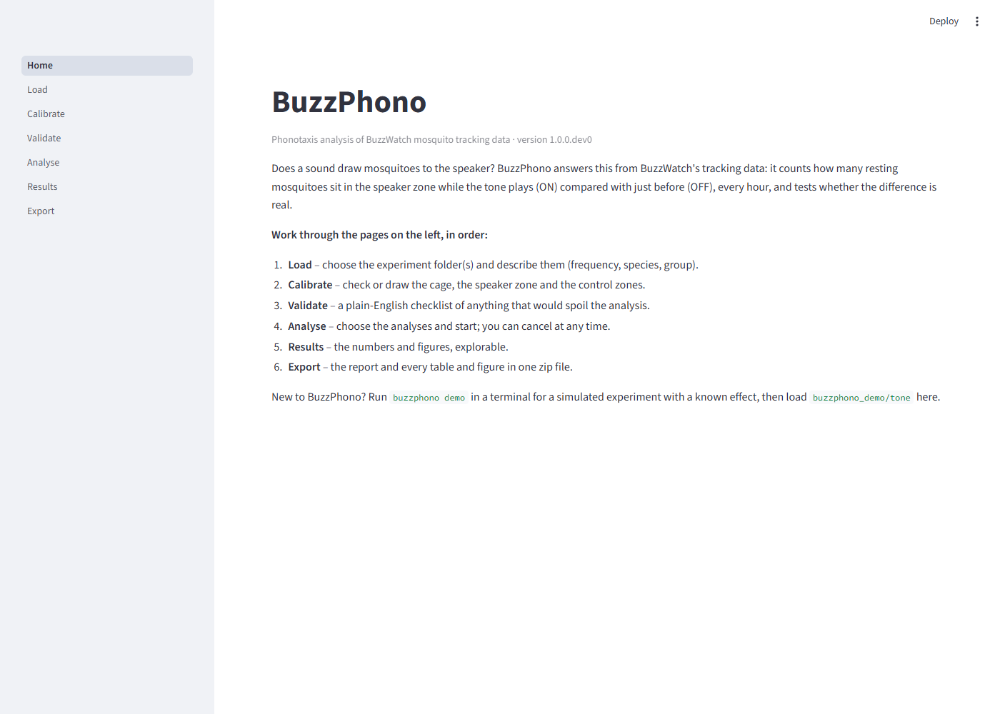
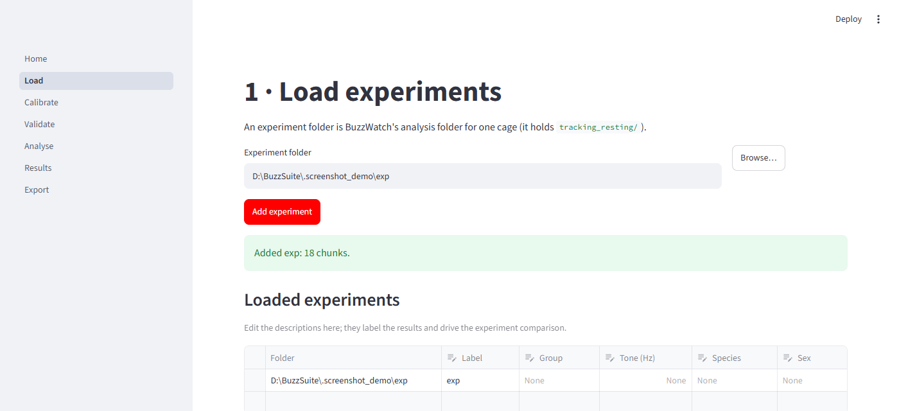
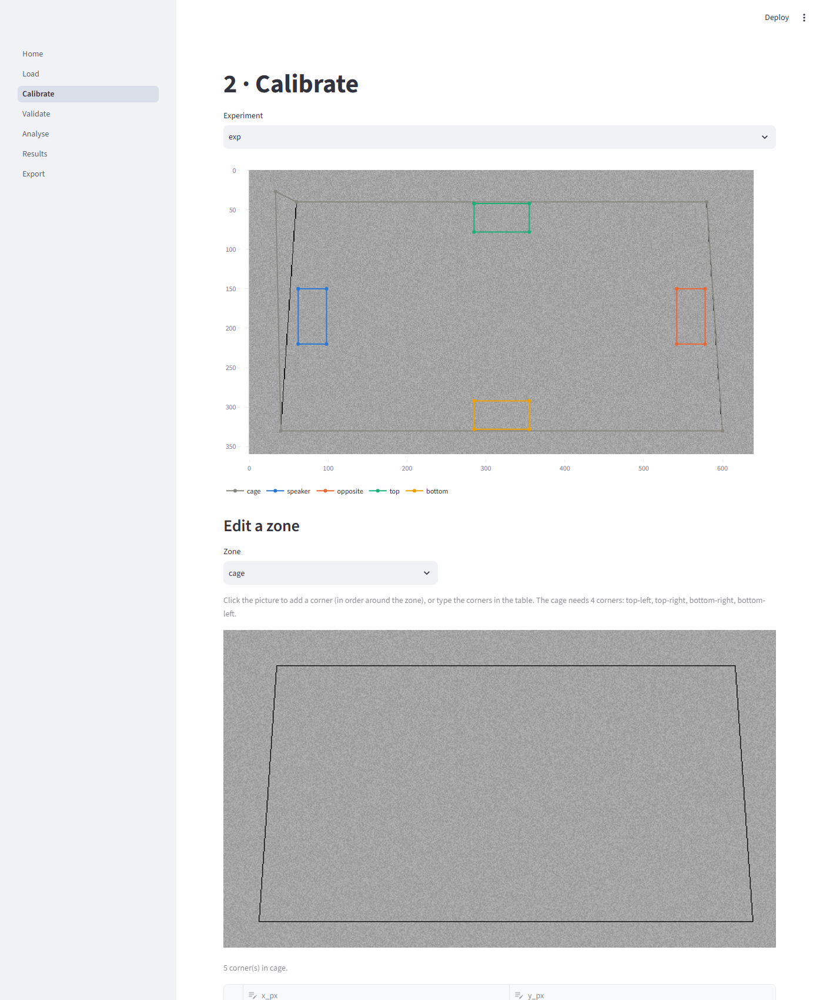
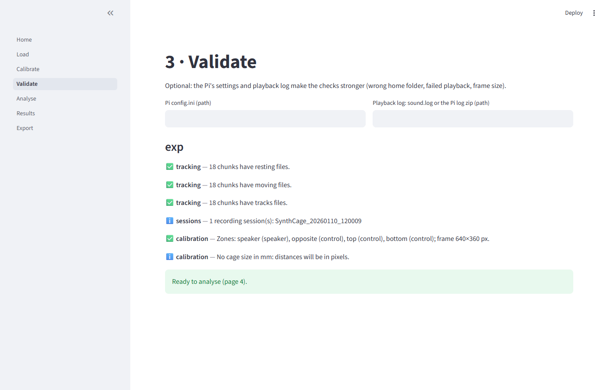
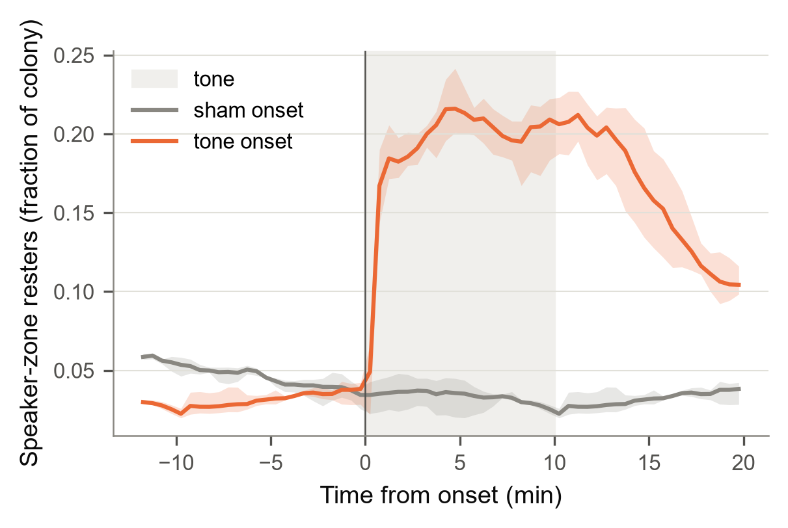
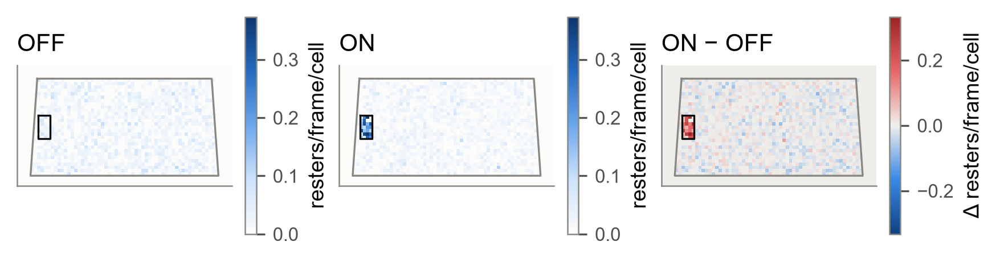
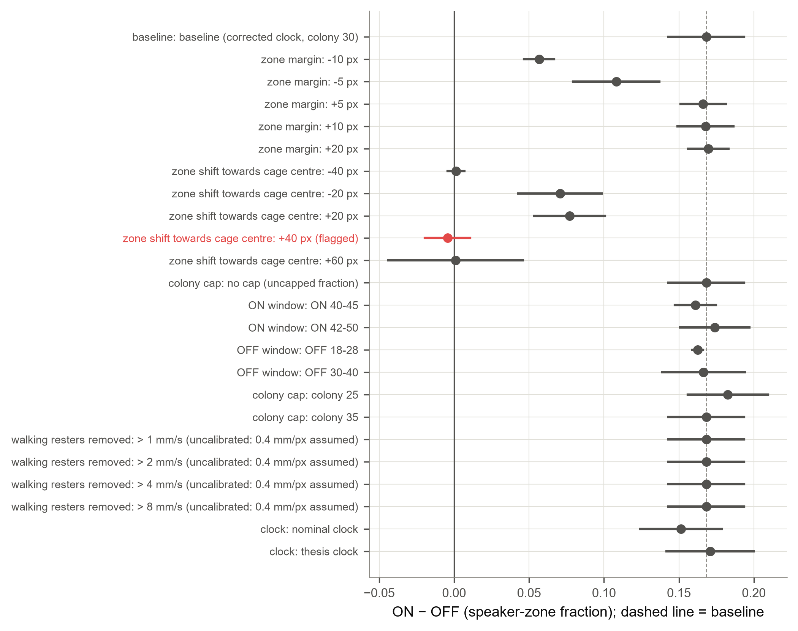

# BuzzPhono guide

BuzzPhono measures **phonotaxis**: whether a sound draws mosquitoes towards the speaker. It reads
the tracking files that BuzzWatch writes for a cage filmed from below. Every hour it compares the
minutes when the tone plays (ON) with the minutes just before (OFF), and asks whether the
difference is real. It also tells you how sure it is, whether the result depends on your
choices, and whether the recording had problems.

This guide covers everything you need. A first analysis of the simulated demo experiment takes a
few minutes.

- [1. Install](#1-install)
- [2. Try the demo](#2-try-the-demo)
- [3. Analyse your own experiment](#3-analyse-your-own-experiment)
- [4. What BuzzPhono measures](#4-what-buzzphono-measures)
- [5. The statistics](#5-the-statistics)
- [6. The recording clock](#6-the-recording-clock)
- [7. Safeguards: what BuzzPhono checks for you](#7-safeguards-what-buzzphono-checks-for-you)
- [8. Outputs](#8-outputs)
- [9. Settings reference](#9-settings-reference)
- [10. Command-line reference](#10-command-line-reference)
- [11. Collecting the Raspberry Pi's logs](#11-collecting-the-raspberry-pis-logs)
- [12. Reproducing the published (2026 thesis) results](#12-reproducing-the-published-2026-thesis-results)
- [13. Troubleshooting](#13-troubleshooting)
- [14. Limitations](#14-limitations)
- [15. For developers](#15-for-developers)

---

## 1. Install

BuzzPhono has its own Python environment, `buzzphono_env` (Python 3.12). It does not touch
BuzzWatch's `buzzsuite_env`. You need [Miniconda](https://docs.conda.io/en/latest/miniconda.html)
or Anaconda.

In a terminal, in the BuzzSuite folder:

```bash
conda env create -f environment-buzzphono.yml
conda activate buzzphono_env
buzzphono --version
```

This installs exact, tested versions of every package (`constraints-buzzphono.txt`), the app and
the test tools. It works the same on Windows, macOS and Linux.

**Updating BuzzPhono later:** run `git pull` in the BuzzSuite folder. The package is installed in
editable mode, so nothing needs reinstalling unless the release notes say so.

**Opening the app without a terminal:** double-click `BuzzPhono.bat` (Windows) or
`BuzzPhono.command` (macOS). Both find `buzzphono_env` by themselves. If yours is somewhere
unusual, set the environment variable `BUZZPHONO_PYTHON` to its `python` executable. In
BuzzSuite, the **Phonotaxis** tab has the same **Open the BuzzPhono app** button.

---

## 2. Try the demo

```bash
buzzphono demo buzzphono_demo --open
```

This simulates two cages of 30 mosquitoes for 72 hours (four calendar days) and analyses them,
which takes a few minutes. `--hours 24` is quicker but too short for a firm conclusion; see
[section 5](#5-the-statistics):

- **tone**: the tone draws resting mosquitoes to the speaker;
- **no_tone**: nothing happens when the "tone" is due.

The `--open` flag opens the report in your browser when the run finishes.

- **The tone cage** should be concluded "Evidence of an effect". The sham should be close to 0,
  and the tone-minus-sham comparison should exclude 0.
  - The control zones change far less than the speaker zone; a small drop there is expected,
    because mosquitoes recruited to the speaker leave other places.
  - Moving the zone far off the speaker removes the effect, as it should, and the sensitivity
    analysis does not flag that.
  - The simulated flyers are aroused by the tone but do not make extra approach bouts, so the
    approach table shows no increase. It may even show a small decrease, because more of the
    flight during the tone is undirected.
- **The no-tone cage** should show no clear effect. About one test in twenty on a null experiment
  is below 0.05 by chance, which is why the conclusion needs several tests to agree.

The simulated files have the same format as BuzzWatch's (at 2 frames per second, stated in each
cage's `buzzwatch_track_settings.yml`), so the demo exercises the whole pipeline except the flight
analysis (which needs 25-fps video). Each demo cage also holds a `pi_config.ini` and a `sound.log`.
Try them with `buzzphono validate` (section 3) to see the Pi checks.

**Where the results are:** `buzzphono_demo/results/<date-time>-<id>/`. Without `--open`, open
`report.html` there in any browser, or run `buzzphono report <that folder>`. The run's folder is
printed at the end of the run.



*Each grey line is one hour of the recording: the fraction of the colony resting in the speaker
zone during the 10 minutes before the tone (OFF) and the 10 minutes of the tone (ON). The dots are
the means with 95% intervals.*

---

## 3. Analyse your own experiment

You need:

- the experiment's BuzzWatch analysis folder, which contains `tracking_resting/`,
  `tracking_moving/` and `final_tracking_data/`;
- the speaker zone (and ideally control zones) drawn on the cage picture.

### In the app

Open the app (`buzzphono app`, the launcher, or BuzzSuite's Phonotaxis tab) and work through the
pages in order.



1. **Load.** Paste the experiment folder, or click **Browse…**, then click **Add experiment**.
   Describe each experiment (tone frequency, species, sex, group). These labels name the results
   and drive the comparison between experiments. BuzzPhono never guesses them from folder names.

   

2. **Calibrate.** The cage picture shows the cage outline and every zone.
   - **Existing zones:** BuzzPhono imports your existing `custom_zones.json` and the cage corners
     from `buzzwatch_track_settings.yml`.
   - **Editing:** choose a zone, then click the picture to add corners in order around it, or
     type them in the table.
   - **Roles:** exactly one zone is the *speaker*. *Control* zones should be the same size on the
     other walls; they are compared with the speaker. *Other* zones, such as feeders, are only
     drawn.
   - **Size in mm (optional):** give the cage's inner width and height in mm if you want
     distances in mm.
   - **Save:** click **Save calibration**. It writes `buzzphono_calibration.json` into the
     experiment folder. BuzzPhono never changes the tracking files.
     - **What BuzzPhono writes into an experiment folder:** this file (only when you save a
       calibration), plus, by default, its cache and results under `plots/buzzphono/`.
     - **For a read-only data drive:** give `--out` and `--cache` (or `output.dir` and
       `output.cache_dir`) on another drive, and nothing is written next to the data.

   

3. **Validate.** A plain-English checklist: missing or empty tracking files, clock problems,
   frame size against the calibration, and the Pi's settings and playback log if you give them.
   Fix anything marked ❌.

   

4. **Analyse.** Choose the analyses (the headline is *resting fraction*) and click **Run**. The
   analysis runs as its own process: a progress bar follows it, and **Cancel** stops it and deletes
   the partial results. Closing the browser does not stop a run. Defaults that match the Penzance
   and Bangkok rigs are under **Settings**.
5. **Results.** The key statistics, interactive plots (hover for values) and the publication
   figures.
6. **Export.** Download the report, or a zip of everything.

### From the command line

```bash
buzzphono validate "E:\Buzzwatch\Analysis\Phonotaxis\Penzance\MyCage"
buzzphono analyse  "E:\Buzzwatch\Analysis\Phonotaxis\Penzance\MyCage" -a all --open
```

For several experiments, or settings you want to keep, write a settings file (see
[section 9](#9-settings-reference)). Then run:

```bash
buzzphono analyse --config my_experiments.yml
```

Results go to `<experiment>/plots/buzzphono/<date-time>-<settings id>/` unless you give
`--out`.

**Frame rate.** BuzzPhono reads the camera's frame rate from the experiment's
`buzzwatch_track_settings.yml` (`fps:`). If the file does not state one, it uses 25 fps, the
Raspberry Pi rigs' rate. If the frames per 20-minute chunk suggest a different rate, a warning
tells you which value to set with `clock.fps`. The first run of an experiment reads every tracking file into a compact cache, which takes
a few minutes on a hard drive. Later runs reuse the cache and take seconds to minutes.

### From BuzzSuite

`buzzsuite_cli.py phono`, `phono-flight` and `run_all_analysis.py` now run BuzzPhono. The
Phonotaxis tab can analyse the loaded experiment directly, with progress and Cancel.

---

## 4. What BuzzPhono measures

All analyses run on **hour-cycles**: one clock hour of one cage. Within each hour, the tone window
(ON, minutes 40–50 by default) is compared with a baseline (OFF, minutes 28–38, the published
choice).

**Video chunks and the tracker's warm-up.** The Pis cut video into 20-minute chunks counted from
the session start. When a session starts on the hour, a chunk begins at :00, :20 and :40. ON then
starts on a fresh chunk, and the tracker's first two minutes of a chunk are less reliable, while
OFF falls in the middle of one. Two checks guard against mistaking this for an effect:

- the **sham comparison** (minutes 20–30 vs 08–18), which starts on a fresh chunk exactly like ON
  but has no tone;
- the sensitivity variant **ON 42–50**, which leaves out the first two minutes.

**Light phases.** Dawn is the hour that starts at lights-on and dusk is the hour before lights-off
(from `light.lights_on` / `lights_off`, or the Pi's light ramps). Day is the hours between them and
night the rest. For example, lights 05:00–17:00 give dawn 05–06, day 06–16, dusk 16–17 and night
17–05. A phase is tested only with at least 4 hour-cycles; otherwise its row says "not tested".
Dawn and dusk contribute one hour per day, so they need at least 4 recorded days to be tested.
Phase rows are descriptive: read their Holm-adjusted p-values. Only the all-phase row carries a
conclusion.

### 4.1 Speaker-zone resting fraction (headline)

For every video frame BuzzPhono counts the resting detections, `n`, and those inside the speaker
zone, `n_in`. The tracker sometimes detects one mosquito twice and counts static specks, so the
counts are capped at the colony size C (30 by default): `total = min(n, C)` and
`in = min(n_in, total)`. Over a window:

    colony_frac_in_zone = Σ in / Σ total

The **ON − OFF difference per hour-cycle** is the primary result. When the cap binds, as it does
in almost every frame of a full cage, this is essentially *speaker-zone resters ÷ colony*.

Three companions are always computed, so the effect of the cap is never hidden. All three are in
`cycles/cycle_table.csv`; the uncapped one is also tested in `statistics.csv`:

- the uncapped `resting_frac_in_zone`;
- the mean of per-frame fractions;
- the raw count per frame.

**Choosing control zones.** Draw one zone of the same size and shape as the speaker zone on each
of the other walls, at the same height. Each should sit where the cage looks like the speaker's
wall but has no speaker, and at least a zone's width from any feeder or corner.
- **Roles:** name feeders `feeder…` (or give them the role *other*). Any zone in
  `custom_zones.json` that is not named `speaker` becomes a control, except feeders.
- **Use:** the speaker-minus-control comparison uses every control, after scaling each to the
  speaker zone's area.

Two control comparisons come with every run:

- **Sham:** the same comparison at minutes 20–30 vs 08–18, when no tone plays. A real effect shows
  at the tone and not at the sham.
- **Control zones:** the same ON − OFF change in the control zones, scaled to the speaker zone's
  area. A real phonotaxis effect is specific to the speaker.

### 4.2 Attraction index

`(ON − OFF) / (ON + OFF)` per hour-cycle, between −1 and +1. It is useful for comparing cages with
different baselines. An hour with zero in both windows has no index; it is counted and reported,
not dropped silently.

### 4.3 Time course around the onset (PSTH)

The speaker-zone fraction, resting count, flight activity and moving detections in 30-second bins,
from 12 minutes before to 20 minutes after the tone onset. Each is drawn with a 95% band, and the
sham onset is drawn as a control. Each bin is tested against its own pre-onset baseline, and
the p-values are corrected for the number of bins.



### 4.4 Time of day

The ON − OFF difference for each hour after lights-on (zeitgeber time, ZT), with 95% intervals,
and the whole recording minute by minute. Light phases (dawn, day, dusk, night) come from the
settings, or from the Pi's light schedule.

### 4.5 Where they rest (spatial)

Maps of resting mosquitoes per frame during OFF, during ON, and ON − OFF (on a symmetric scale).
They come with a radial profile: occupancy per unit cage area by distance from the speaker zone.
Seeded random samples of flight tracks are saved for overlays.



### 4.6 Directed flight (approach)

Approach bouts are falls in a flying mosquito's distance to the speaker zone. A fall counts when it
closes at least 20 mm (or 15% of the cage width) within at least 0.4 s, after smoothing out the
tracker's position jitter. The measures are bouts per flight-second, approach speed, minimum
distance and zone entries.

**Validation:** approach bouts passed the positive-control check on three *Aedes aegypti* cages
(more during the tone, none at the sham). A second measure, the mean radial velocity towards the
speaker, did **not** pass: it is dominated by take-offs from the speaker zone. It is reported but
labelled *measure not validated*, and you should not use it as evidence of approach. The
`validation` column describes the **measure**, not your result: a validated measure can still
show no effect in your experiment.

### 4.7 Reliability

How much of the ON − OFF difference varies between cages, between days of one cage, and between
hours. Reported as:

- intraclass correlations (ICC) with intervals;
- the **minimum detectable effect** (MDE) at 80% power for your design. It is computed from the
  noncentral t with cage-days − 1 degrees of freedom, matching the primary test. Quote
  `mde_analytic`: `mde_bootstrap` is only a cross-check, and with fewer than about 10 cage-days it
  is unreliable (too small);
- a planning table: the MDE for 4 to 32 cage-days, so you can size the next experiment.

With fewer than five cages the between-cage part is very imprecise, and the table says so.

### 4.8 Sensitivity

The headline is recomputed with one choice changed at a time:

- the zone grown or shrunk by −10 to +20 px;
- the zone moved −40 to +60 px towards the cage centre;
- colony cap 25 / 35 / none;
- walking resters removed above 1–8 mm/s;
- other ON and OFF windows;
- every other clock.

Every variant uses the same hours. Flags apply only when the baseline's interval excludes 0. With
no clear effect, every variant "flips sign" by chance, and the `flag_note` column says so. A
variant is **flagged** (`flagged` = True, the reason in `flag`) in either of these cases:
- its own interval excludes 0 on the other side (a real reversal, not a wobble around 0);
- a change of at most 5 px in the zone changes the effect by more than half.

Zone *shifts* larger than half the zone's width are never flagged for a reversal. Moving a 36-px
zone by 40 px takes it off the speaker, and the effect *should* then vanish: that is the expected
spatial specificity, not fragility. A grown zone still contains the speaker, so growth is not
exempt. `zone_change_rel_width` gives each change as a fraction of the zone width.

Larger changes can shrink the effect a lot without being flagged; for example, shrinking the zone
by 10 px can cut it by more than half. Read the whole curve, not only the flags.

**What to do with a flag:**
- **Small zone changes (±5–10 px):** the zone outline matters too much. Check the zone on the
  picture and report the specification curve.
- **Window or clock variants:** report both values and the reason for your choice.

A robust result keeps its sign across all small, sensible choices.



### 4.9 Comparing experiments (tuning curve)

Each experiment's effect with its interval, against tone frequency, stimulus type, species, sex
and group. Experiments differ in more than the tone: cage, date, rig and colony all differ too.
BuzzPhono therefore states which descriptors always change together (for example "every 475 Hz
run was also the only *Aedes* run"), and compares groups only when each has at least three
experiments.

### 4.10 Flight phonotaxis

The flight analyses of the 2026 flight-phonotaxis study, ported unchanged:

- arousal: flyers, take-offs and flight activity;
- where flyers go: near each wall's zone, wall sectors, entries and dwell;
- landings and take-offs per zone;
- linked take-off → landing bouts;
- distance from each wall.

They need four zones, one per wall (the speaker plus three others; feeders count as walls), and
25-fps video. At other frame rates the flight analysis is skipped with a warning, because its speed
and time thresholds are defined in 25-fps frames.

---

## 5. The statistics

The full plan, fixed before any new result was looked at, is in [STATS_PLAN.md](STATS_PLAN.md).
In short:

- **The unit is the hour-cycle**, but hours of the same cage-day are not independent: a cage that
  responds strongly at 10:00 probably does at 11:00 too. Treating every hour as independent makes
  p-values far too small. In simulations with realistic hour-to-hour correlation, the per-hour
  Wilcoxon test gave false positives in up to 29% of null experiments instead of 5%.
- **Primary test: the wild cluster bootstrap-t (Webb weights) at cage-day level.** It allows any
  correlation within a cage-day, and its false-positive rate stayed at about 5% in the same
  simulations. Report its p-value and 95% interval.
- **Also reported:**
  - the Wilcoxon signed-rank test, for continuity with earlier work;
  - a block sign-flip permutation test (12-hour blocks within cage-day);
  - a linear mixed model (random intercept per cage-day) as a sensitivity check, with its
    convergence and singularity status. "Singular" means the cage-day variance was estimated as 0.
    The model then reduces to an ordinary regression, which is common with few cage-days and not
    an error. Its estimate is phase-balanced (each light phase weighted equally).
- **Effect sizes:** mean and median difference, Hodges–Lehmann estimate, rank-biserial
  correlation, Cohen's dz and fold change.
- **Multiple comparisons:**
  - Holm correction across light phases;
  - Benjamini–Hochberg across PSTH bins, sensitivity variants and experiments.
- **Two-sided by default.** Use `stats.alternative: greater` only if the direction was fixed
  before seeing the data.

**Few cage-days.**
- **Fewer than 6 cage-days:** the wild bootstrap's interval is too narrow. BuzzPhono then uses a
  CR2 cluster-robust t-test with Bell–McCaffrey degrees of freedom instead (G − 1 when cage-days
  are equal in size). It has the same estimate, the mean over hour-cycles, and its interval always
  contains that estimate. The `wild_cluster_method` column names the test used. The `wild_cluster_*`
  columns hold whichever primary test was used, and the report labels them "primary".
- **Several cages:** the same test with whole cages as clusters is reported as `cage_cluster_*`.
  Neighbouring days of one cage are not fully independent, so a conclusion that this check does
  not confirm says "(not confirmed with whole cages as units)". The conclusions are about the
  cages recorded; generalising to other cages needs more of them (see section 4.7).
- **One cage-day:** no interval can be computed at all; the columns are empty and a warning says
  why.
- **Units:** a recording of one cage over two days holds only two independent units, so its
  interval is wide and its p-value modest. Pool cages, or record at least four days per cage.

**The conclusion** in `statistics.csv` (column `conclusion`) and at the top of each experiment in
the report follows the plan's wording rule:

| conclusion | when |
|---|---|
| **Evidence of an effect** | the main effect passes (primary 95% interval excludes 0, primary p < 0.05, block sign-flip p < 0.05), the tone's change exceeds the sham's (row "tone minus sham": interval excludes 0, same sign) and, with several cages, the whole-cage interval excludes 0 too |
| **Not confirmed across cages** | as above, but with whole cages as units the interval includes 0: the effect may belong to particular cages |
| **Effect seen, but not shown to exceed the sham** | the main effect passes, the sham itself shows no clear change, but the tone-minus-sham contrast is inconclusive (it is noisier than the main comparison; more cage-days help) |
| **Not attributable to the tone** | the main effect passes, but the sham shows a clear change of the same sign (e.g. the tracker's warm-up at a chunk start) |
| **Suggestive only** | only the per-hour Wilcoxon test is below 0.05; it ignores the clustering of hours within days, so this is not support for an effect |
| **No clear effect** | otherwise |

The block test cannot reach p < 0.05 with fewer than about 6 twelve-hour blocks. A single cage
recorded for 2 days can therefore be "Suggestive" at most.

**Secondary analyses (family F2).** The main contrast of each secondary analysis run is Holm-adjusted
across that family (`multiplicity/secondary_family_F2.csv`). The contrasts are:
- the attraction index;
- the PSTH onset response (5 minutes after the onset vs the 5 before);
- approach (directed velocity);
- the fraction within 20 px of the speaker zone.

**Reporting in a paper.** A methods paragraph to adapt. Every value in brackets is in the run's
`run_manifest.json` (settings and `buzzphono_version`, `source_sha256`):

> Phonotaxis was analysed with BuzzPhono [version; source hash]. For each clock hour, the fraction
> of the colony ([colony size] mosquitoes) resting in the speaker zone during the tone (minutes
> [40–50]) was compared with minutes [28–38]. Per-frame counts were capped at the colony size, and
> windows had to contain at least 80% of their frames, no gap over 2 min, and resting detections
> in at least 8 of 10 minutes. Recording times were corrected for camera clock drift using the
> tone-evoked flight burst [or: "were taken from the session start at the nominal frame rate",
> when the report says the clock was nominal]. The mean difference was tested with a wild
> cluster bootstrap-t with Webb weights at the cage-day level (Cameron, Gelbach & Miller 2008;
> Webb 2014). With fewer than 6 cage-days, a CR2 cluster-robust t-test with Bell–McCaffrey
> degrees of freedom was used instead (Bell & McCaffrey 2002; Pustejovsky & Tipton 2018).
> Supporting tests were a sign-flip permutation test on 12-hour blocks and the Wilcoxon
> signed-rank test (Wilcoxon 1945). The change during the tone was compared with the same change
> at a sham onset at the same video-chunk position, and with area-matched control zones. Phases
> were Holm-corrected (Holm 1979), and exploratory families with the Benjamini–Hochberg procedure
> (Benjamini & Hochberg 1995). The analysis followed BuzzPhono's pre-specified plan
> (STATS_PLAN.md, at the source hash above).

Lead with the mean difference and its 95% interval, then the conclusion, n (hour-cycles and
cage-days), the sham and the control-zone result. Put the sensitivity curve in a supplement.

- Bell RM, McCaffrey DF (2002) *Survey Methodology* 28:169–181.
- Benjamini Y, Hochberg Y (1995) *J R Stat Soc B* 57:289–300.
- Cameron AC, Gelbach JB, Miller DL (2008) *Rev Econ Stat* 90:414–427.
- Holm S (1979) *Scand J Stat* 6:65–70.
- Pustejovsky JE, Tipton E (2018) *J Bus Econ Stat* 36:672–683.
- Webb MD (2014) Reworking wild bootstrap based inference for clustered errors. Queen's Economics
  Department Working Paper 1315.
- Wilcoxon F (1945) *Biometrics Bull* 1:80–83.

**One-sided tests.** With `stats.alternative: greater`, p-values are one-sided, but the intervals
stay two-sided 95%. A one-sided test at 0.05 matches a two-sided 90% interval.

Every statistics table includes the assumptions of each test, and the report repeats them.

---

## 6. The recording clock

The Pi's camera does not run at exactly 25 frames per second, and its clock is not always right.
In the Penzance rigs the video drifts by about 50 seconds a day. BuzzPhono has three clocks:

- **corrected (default).**
  1. Frames are placed using each chunk's real frame count, with no overlaps or gaps.
  2. The clock is calibrated on the burst of flight the tone evokes every hour: the onset of that
     burst is found in each hour and regressed on time, giving one offset per recording session
     and one drift per experiment.
  3. The fit needs at least 8 bursts, with at least 3 in one session. It must keep at least half
     of those found, its kept bursts must agree within 30 s, and its drift must be below
     300 s/day. Otherwise BuzzPhono says so and uses the nominal clock, or the rig's known drift
     if you give it (`clock.rig_drift_s_per_day`).
- **nominal:** real frame counts at exactly 25 fps from each session's start.
- **thesis:** the clock of the published 2026 analysis (1200 s per chunk), kept only to reproduce
  those numbers.

The report states which clock each session used and why. Because the fit anchors on the response
itself, latency measures are computed with each hour's clock fitted on the *other* hours.

---

## 7. Safeguards: what BuzzPhono checks for you

| Problem | What BuzzPhono does |
|---|---|
| Corrupt, truncated or empty tracking files | Each is reported by name and skipped; `--max-bad-chunks` turns too many into an error |
| Files from a different program, or a tampered pickle | Refused: the reader only accepts BuzzWatch's own objects |
| Camera moved, or resolution changed | Refuses a calibration whose frame size differs from the video's |
| Untrusted Pi clock | Corrected clock; flags impossible dates, `-attempt` re-recordings, missing and short chunks, overlapping sessions, clock changes and daylight-saving changes |
| The tone did not play | With the playback log, failed and unplayed windows are excluded; hours outside `stimulus.active_from`–`active_until` are excluded |
| Typos in the Pi's `config.ini` (e.g. `/home/penzance/` on a Pi whose user is `penzancepi`) | Named in plain English, with the field |
| Typos in BuzzPhono's settings | Refused, with "did you mean …?" |
| Thin windows (gaps, dropped frames) | The coverage rule: at least 80% of frames, no gap over 2 min, resting detections in at least 8 of 10 minutes |
| Tracker over-counting in crowded zones | Colony cap; the uncapped fraction is reported alongside |
| Results depend on choices | Sensitivity analysis with flags |
| Pixels vs mm confusion | Every column and axis carries its unit; mm only through the cage-size calibration |
| Reproducibility | `run_manifest.json` records settings, input file identities, software versions and output hashes |

---

## 8. Outputs

```
<run folder>/
  report.html                    the report: open this first
  run_manifest.json              exactly how the results were made
  status.json, events.jsonl      progress record (runs started with `analyse` or the app)
  experiments/<label>/
    cycles/cycle_table.csv       one row per hour-cycle: every window, metric and coverage
    resting_fraction/statistics.csv, assumptions.csv
    attraction_index/  psth/  zt_profile/  spatial/  approach/  reliability/  sensitivity/  flight/
    figures/*.png (300 dpi), *.svg, *.pdf
  pooled/                        all experiments together, the comparison table, confounds
```

Every table is tidy CSV: one row per observation, units in the column names (`_px`, `_mm`, `_s`,
`_frac`, `_per_s`, `_per_min`). The key columns of `statistics.csv`:

| column | meaning |
|---|---|
| `comparison`, `phase` | what is compared (e.g. ON vs OFF), and for which light phase (`all` = pooled) |
| `n` | hour-cycles used |
| `mean_off`, `mean_on`, `mean_delta` | means, and the mean ON − OFF difference |
| `wild_cluster_ci_low/high`, `wild_cluster_p_value` | primary 95% interval and p-value |
| `block_signflip_p_value`, `wilcoxon_p_value` | secondary tests |
| `hodges_lehmann`, `rank_biserial`, `dz`, `fold_change` | effect sizes |
| `*_p_holm_phases` | Holm-corrected across phases |
| `mixed_model_*` | mixed-model estimate, interval and status |
| `wild_cluster_method` | which primary test was used (wild bootstrap, or the cluster-robust t below 6 cage-days) |
| `n_cages`, `n_cage_days` | independent units behind the row |
| `conclusion` | the wording rule's verdict (section 5) |

Other folders:
- `clock/tone_onset_bursts.csv`: the bursts the clock was fitted on. The clock used is also in
  the report's data-quality table.
- `flight/`: the flight tables.
- `multiplicity/`: the F2 family.
- `psth/onset_response.csv` and `spatial/band_statistics.csv`: the F2 contrasts.

Figures are deterministic: the same data give byte-identical files.

---

## 9. Settings reference

A settings file is YAML. Only `experiments` is required; everything else has a default. Relative
paths are relative to the settings file.

```yaml
experiments:
  - path: E:/Buzzwatch/Analysis/Phonotaxis/Penzance/CageA   # experiment folder
    label: CageA                # name in outputs (default: folder name)
    group: treated              # for comparisons
    frequency_hz: 475
    stimulus_type: tone         # tone | file | piezo | none
    species: Aedes aegypti
    sex: male                   # male | female | mixed
    start: 2026-06-04 00:00     # optional analysis window
    end: 2026-06-06 00:00
    calibration: null           # default: <folder>/buzzphono_calibration.json, else imported
analyses: all                 # or a list, e.g. [resting_fraction, psth]
stimulus:
  on: 40-50                     # minutes of every hour
  off: 28-38
  sham_on: 20-30
  sham_off: 08-18
  pre: null                     # attraction-index baseline (default: off)
  source: auto                  # auto | playback_log | pi_config | schedule
  playback_log: []              # sound.log files or the Pi log zip
  pi_config: null               # the Pi's config.ini
  active_from: "00:00"          # hours when the tone schedule was active
  active_until: "24:00"
clock:
  mode: corrected               # corrected | nominal | thesis
  fps: null                   # default: from buzzwatch_track_settings.yml, else 25
  rig_drift_s_per_day: null     # used if the burst fit fails (Penzance ≈ 51)
  manual_offset_s: {}           # {session: seconds}
light:
  lights_on: "05:00"
  lights_off: "17:00"
  source: auto                  # auto: from the Pi config.ini when given
metric:
  colony_size: 30
  speaker_zone: speaker
  coverage: {min_frame_fraction: 0.8, max_gap_s: 120, min_minutes_with_resting: 8}
flight: {flyer_multiplier: 1.0, min_median: 0.0, radius_cage_widths: 0.1}
approach: {min_points: 10, smoothing_frames: 5, min_drop_mm: 20, min_drop_cage_fraction: 0.15, min_duration_s: 0.4}
sensitivity:
  zone_margins_px: [-10, -5, 0, 5, 10, 20]
  zone_shifts_px: [-40, -20, 0, 20, 40, 60]
  walking_thresholds_mm_s: [1, 2, 4, 8]
  colony_sizes: [25, 30, 35]
stats: {alternative: two-sided, alpha: 0.05, n_resamples: 9999, block_hours: 12, seed: 20261104}
output: {dir: null, cache_dir: null, formats: [png, svg, pdf], dpi: 300, report_pdf: false}
                              # dir / cache_dir null: inside <experiment>/plots/buzzphono/
workers: null                   # processes reading files (default: suits the drive and memory)
```

---

## 10. Command-line reference

| command | what it does |
|---|---|
| `buzzphono analyse [FOLDERS] [-c settings.yml] [-a list\|all] [--clock …] [-o DIR] [--workers N] [--open]` | run analyses |
| `buzzphono validate FOLDER [--pi-config config.ini] [--playback-log sound.log]` | pre-flight checklist |
| `buzzphono calibrate FOLDER [--speaker "x,y x,y …"] [--control "name=x,y …"] [--cage …] [--width-mm W --height-mm H] [--click]` | write the calibration |
| `buzzphono demo [FOLDER] [--hours H] [--open]` | simulated experiments with a known effect |
| `buzzphono app` | open the app |
| `buzzphono compare RUN… -o DIR` | compare earlier runs |
| `buzzphono plot RUN` | redraw a run's figures from its tables |
| `buzzphono report RUN` | open a run's report |
| `buzzphono status RUN [--cancel]` | a run's progress; ask it to stop |
| `buzzphono cache info\|verify\|clean FOLDER` | inspect, check or delete the cache |

**Exit codes:**

| code | meaning |
|---|---|
| 0 | success |
| 1 | internal error (please report it) |
| 2 | command-line usage |
| 3 | settings or validation problem |
| 4 | data problem |
| 5 | calibration problem |
| 130 | cancelled |

---

## 11. Collecting the Raspberry Pi's logs

The playback log tells BuzzPhono which tone windows really played. Copy
`tools/pi_collect_logs.py` to the Pi and run it there. It needs Python 3.9 or later and nothing
else:

```bash
python3 pi_collect_logs.py --out ~/pi_logs.zip      # add --since 2026-10-01 to limit the journal
```

The zip holds `sound.log`, the `buzzwatch-sound` service journal and `config.ini`. Give it to
`--playback-log` (or the Validate page), and give `config.ini` to `--pi-config`. Check the script
first with `python3 pi_collect_logs.py --self-test`.

---

## 12. Reproducing the published (2026 thesis) results

```bash
buzzphono analyse <thesis cage folders> --clock thesis -a resting_fraction
```

The thesis clock reproduces the published per-cage tables value for value. They are written as
`resting_fraction/thesis_*.csv`. On the analysis PC, a golden test checks this against the
published files on every full test run.

The corrected clock gives slightly different, more accurate numbers: it removes the clock drift
and the 2.4-second chunk overlaps of the thesis clock.

---

## 13. Troubleshooting

| message | what to do |
|---|---|
| *No tracking files* | Track the experiment in BuzzWatch first; BuzzPhono reads `tracking_resting/` etc. |
| *The video frames are W×H px but the calibration is for …* | The camera or its resolution changed. Calibrate again, on a picture from this recording |
| *Not enough tone-onset bursts … using the nominal clock* | The tone evoked too little flight to calibrate the clock. Results are still valid on the nominal clock; give `clock.rig_drift_s_per_day` if you know the rig's drift |
| *only N usable hour-cycles* | Too many hours failed the coverage rule. Check the Validate page for missing chunks |
| *A worker process stopped abruptly* | Short of memory: use `--workers 2`. In your own scripts, start with `if __name__ == "__main__":` |
| *Another BuzzPhono run … is working on this experiment's cache* | Wait for it to finish, or cancel it (`buzzphono status RUN --cancel`) |
| The app does not open | Run `buzzphono app` in a terminal to see the message; check `buzzphono_env` exists |

---

## 14. Limitations

- **Few cages:** between-cage statements (cage ICC, cage-level generalisation) need at least
  five cages.
- **Directed flight:** radial velocity failed the positive control; use approach bouts. Approach
  bouts were not compared with approaches to the other walls, so a general increase in tortuous
  flight is not excluded.
- **Fixed rig assumptions:** the flight analyses assume 25-fps video and one zone per wall.
- **Walking threshold:** without a cage size in mm, the walking-rester threshold assumes 0.4 mm
  per pixel.
- **The Pi's clock:** BuzzPhono corrects drift and detects most clock problems. An hour-sized
  error in a single-session recording with no lights-on/off change, no playback log and no
  responding mosquitoes cannot be detected from the data alone.

---

## 15. For developers

- **Layout:** the package is in `src/buzzphono/` and the tests in `tests/buzzphono/`.
  `src/buzzphono/CLAUDE.md` describes the code conventions.
- **Tests:** `pytest -m "not slow and not golden and not realdata and not browser"` is the CI set.
  The golden and real-data tests run only where the data are, and the browser tests need Edge or
  Chrome.
- **Checks:** `ruff check src tests tools`, `ruff format --check src tests tools`, `mypy` (strict).
- **CI** runs on Windows, macOS and Linux (`.github/workflows/buzzphono.yml`).
